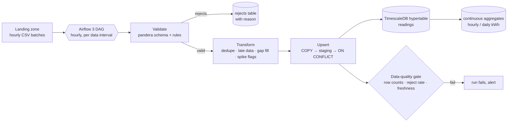

# meterflow

A batch telemetry pipeline for smart-meter energy readings, built the way I'd run one in production:
**validate before you load, make every run idempotent so backfills are boring, and let the time-series database
do the time-series work.**

| | |
|---|---|
| **Orchestration** | Airflow 3 (TaskFlow API, `airflow.sdk`), one run per hourly data interval, catch-up and backfill friendly |
| **Validation** | pandera schema plus business rules. Bad rows go to a `rejects` table with a reason instead of being dropped silently |
| **Transform** | pandas: dedupe by (meter, timestamp) keeping the latest delivery, 15-minute resampling, small-gap interpolation marked `estimated`, spike flags from a rolling robust z-score |
| **Storage** | TimescaleDB hypertable (1-day chunks), compression after 7 days, 400-day retention, hourly and daily continuous aggregates with refresh policies |
| **Idempotency** | every load is an upsert keyed by (meter_id, ts). Re-running any interval gives the same table, so backfills are safe |
| **Quality gate** | each run checks reject rate, expected-row coverage and freshness, and fails loudly instead of loading garbage quietly |

Key decisions are recorded as ADRs in [docs/adr](docs/adr).

## Roadmap

| # | Milestone | Status |
|---|---|---|
| 1 | Synthetic meter-data generator (with realistic faults), validation, transforms, TimescaleDB schema, idempotent loader | in progress |
| 2 | Airflow 3 DAG (hourly intervals, backfill), DAG tests + an end-to-end `dag.test()` run in CI against TimescaleDB | planned |
| 3 | Data-quality gate, run metadata, continuous-aggregate queries and an example dashboard | planned |

## Licence

MIT
