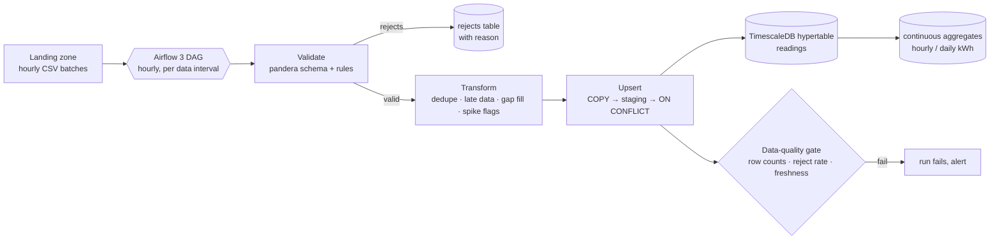

# meterflow

A batch telemetry pipeline for smart-meter energy readings, built the way I'd run one in production:
**validate before you load, make every run idempotent so backfills are boring, and let the time-series database
do the time-series work.**

| | |
|---|---|
| **Orchestration** | Airflow 3 (TaskFlow API, `airflow.sdk`), one run per hourly data interval, catch-up and backfill friendly |
| **Validation** | pandera schema plus business rules. Bad rows go to a `rejects` table with a reason instead of being dropped silently |
| **Transform** | pandas: dedupe by (meter, timestamp) keeping the latest delivery, 15-minute resampling, small-gap interpolation marked `estimated`, spike flags from a rolling robust z-score |
| **Storage** | TimescaleDB hypertable (1-day chunks), compression after 7 days, 400-day retention, hourly and daily continuous aggregates with refresh policies |
| **Idempotency** | every load is an upsert keyed by (meter_id, ts). Re-running any interval gives the same table, so backfills are safe |
| **Quality gate** | each run checks reject rate, expected-row coverage and freshness, and fails loudly instead of loading garbage quietly |

Key decisions are recorded as ADRs in [docs/adr](docs/adr).

## Pipeline stages (milestone 1)

- **Generator** (`meterflow/generator.py`): deterministic hourly batches of 15-minute readings with a daily load curve, plus the
  faults real feeds have: corrected re-deliveries, negative readings, malformed meter ids, timestamps from the future,
  missing readings, spikes and supply outages. Arrival order is shuffled.
- **Validation** (`validate.py`): a pandera schema (types, ranges, id format) plus a batch-interval rule. Every rejected row
  keeps *all* of its reasons. Outages (0 V) are valid data, flagged downstream, not rejected.
- **Transform** (`transform.py`): dedupe keeping the latest delivery. Single inner gaps are interpolated and marked
  `estimated`, while edge gaps stay missing (no extrapolation). `spike` is flagged against the meter's history when
  available, `outage` at 0 V. Values are never altered.
- **Load** (`load.py`): `COPY` → temporary staging → `INSERT … ON CONFLICT … WHERE excluded.delivered_at >= readings.delivered_at`.
  A stale re-run can't roll back a correction. Rejects are replaced per batch, and continuous aggregates are refreshed
  for the touched window (autocommit, as TimescaleDB requires).

Tests: 20, including integration tests on TimescaleDB 2.30 in CI that check the hypertable and policies, idempotent
re-loads, that a later correction wins over a stale re-run, and that hourly and daily aggregates exactly match raw totals.

## Roadmap

| # | Milestone | Status |
|---|---|---|
| 1 | Synthetic meter-data generator (with realistic faults), validation, transforms, TimescaleDB schema, idempotent loader | ✅ done (#1) |
| 2 | Airflow 3 DAG (hourly intervals, backfill), DAG tests + an end-to-end `dag.test()` run in CI against TimescaleDB | planned |
| 3 | Data-quality gate, run metadata, continuous-aggregate queries and an example dashboard | planned |

## Licence

MIT
